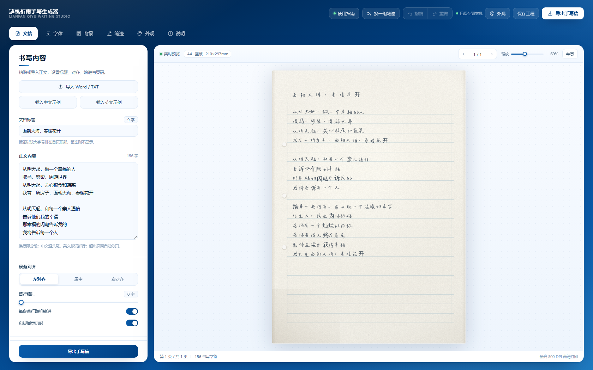
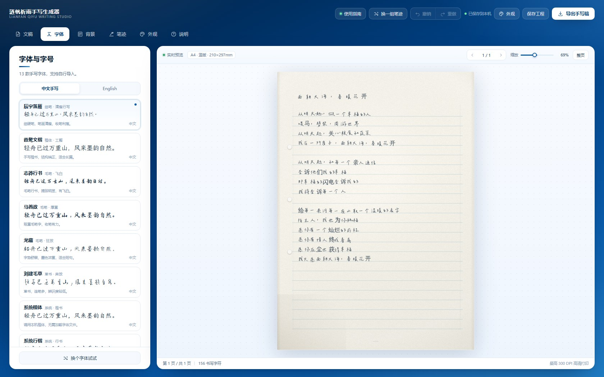
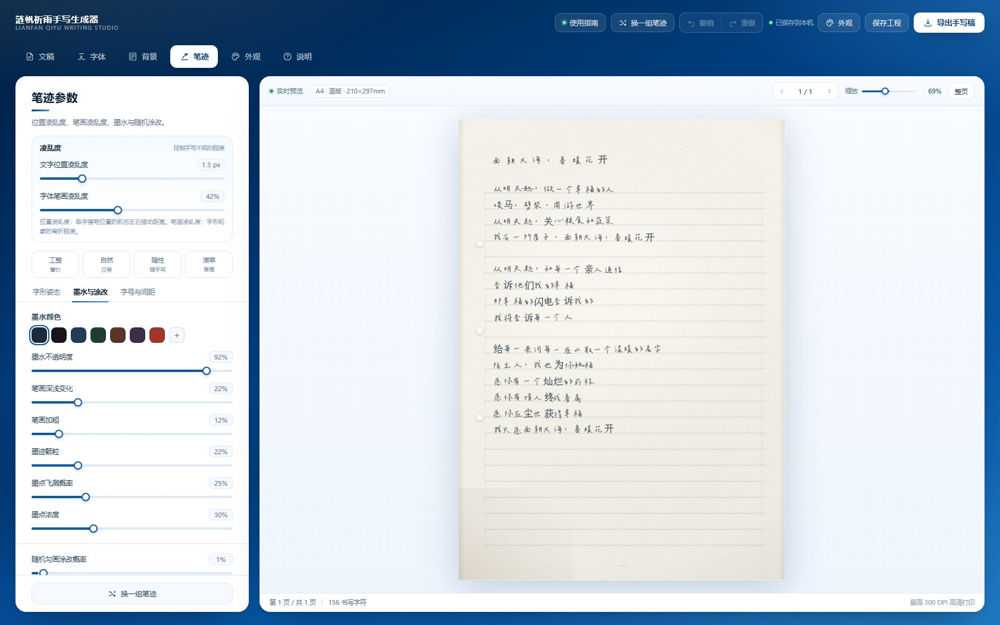
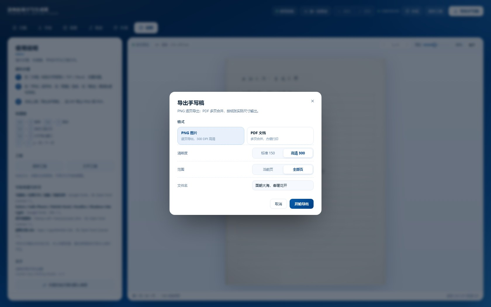

# 涟帆祈雨手写生成器

**LianfanQiyu Writing Studio** · 文字转手写稿

输入文字 → 选字体与纸张 → 调凌乱度与涂改 → 导出 150 / 300 DPI 的 PNG 或 PDF。

本地静态网页，双击 `start.bat` 启动。



## 快速开始

### Windows：双击 `start.bat`

脚本会自动检测 Python / Node.js，在 **<http://127.0.0.1:8080/>** 起一个本地服务并打开浏览器。
8080 被占用时会自动顺延到 8081–8099，窗口里会打印实际地址。

> 运行时请勿关闭窗口。

### 命令行

```bash
# 有 Python 3
python serve.py

# 或只有 Node.js
node server.js
```

然后访问 <http://127.0.0.1:8080/>。

### 为什么必须用本地服务？

浏览器对 `file://` 页面有跨域限制，直接双击 `index.html` 时无法读取本地字体文件，
手写字体全部失效、退化成系统楷体。此时页面顶部会显示一条黄色提示，告诉你改用 `启动.bat`。

### 环境要求

| 运行方式 | 要求 |
| --- | --- |
| `start.bat`| Windows 10/11，装有 Python 3 或 Node.js（二者之一即可） |
| `serve.py` | Python 3.7+ |
| `server.js` | Node.js 14+ |
| 浏览器 | Chrome / Edge / Safari 最新版（需要 Path2D、FontFace、IndexedDB） |

---

## 使用

1. **写内容** —— 「文稿」里粘贴正文，或导入 `TXT / MD / DOCX`；填标题、选对齐。
2. **选字体与纸** —— 「字体」选一款手写体，「背景」选一种纸，比如「实拍横线纸」或「A4 纯白」。
3. **调笔迹** —— 「笔迹」里拖 **文字位置凌乱度** 和 **字体笔画凌乱度**，
   再把 **随机勾画涂改概率** 调到 1%–3%。
4. 点右上角 **导出手写稿**，选 150 / 300 DPI 导出 PNG 或 PDF。

---

## 功能详解

### 文稿

- 粘贴正文；导入 `.txt` / `.md`（自动识别 UTF-8 / GBK）或 `.docx`（JSZip 解包 `document.xml`）
- 文档标题、段落左 / 中 / 右对齐、首行缩进（可开启「每段首行随机缩进」）
- 页脚页码开关
- 中英混排自动断行：中文按字断行，英文按词断行，处理「标点不落行首」的避头尾规则
- 超出页面自动分页，可切换到任意页预览

### 字体（13 款）

- 中文手写 8 款、英文手写 5 款，卡片内即时预览
- 支持导入自己的 `TTF / OTF / WOFF`，保存在浏览器 IndexedDB，下次打开仍在
- 字体缺字时自动用「霞鹜文楷」补写，不会出现方框（例如辰宇落雁缺「绿」字）



### 背景（8 种纸）

| 纸张 | 特点 | 适合 |
| --- | --- | --- |
| 实拍横线纸 | 画布模拟照片：淡蓝横线、分栏竖线、装订孔、纸纹与暗角 | 最像真实稿纸，默认 |
| A4 纯白 | 纯白无格线，几乎无纹理 | 打印、后期叠图 |
| 米色横线 | 暖色纸 + 砖红横线 | 手账、书信 |
| 方格稿纸 | 正方形字格，一字一格 | 作文、练字 |
| 田字格 | 方格 + 虚线对角线辅助 | 练字、教学 |
| 双线信纸 | 上下双线的信笺样式 | 书信 |
| 点阵笔记 | 点阵本风格 | 笔记、手帐 |
| 牛皮纸 | 深色牛皮纸质感 | 题字、短句 |

纸色、线色可自定义；还有纸张颗粒、实拍光照、上下左右页边距（6–45 mm）。

### 笔迹

| 分组 | 参数 |
| --- | --- |
| 凌乱度 | 文字位置凌乱度、字体笔画凌乱度 |
| 字形姿态 | 字形倾斜、大小变化、行内起伏、整行倾斜、字距变化、结构松散度 |
| 墨水与涂改 | 墨水颜色（7 种预设 + 自定义）、不透明度、深浅变化、笔画加粗、墨迹颗粒、墨点飞溅概率 / 浓度、随机勾画涂改概率、涂改样式 |
| 字号与间距 | 字号、行高、字间距、标题字号、首行缩进 |

**涂改样式**：划线、乱线涂抹、画圈、涂黑、擦除重写、混合。
「混合」会按随机数挑一种，涂改位置和力度都由 seed 决定，同一篇稿子每次重绘结果一致。



### 外观

界面以 **#004082** 为中心做渐变蓝 + 纯白卡片，工作台提供 4 套蓝色配色：
深蓝·白（默认）、靛蓝·雾、湖蓝·雪、墨蓝·夜。
**只改界面颜色，纸张与墨色始终保持暖白，不受主题影响。**

### 导出

| 格式 | 说明 |
| --- | --- |
| PNG | 逐页导出，150 / 300 DPI 可选；A4 @300DPI = 2480 × 3508，单页约 14 MB |
| PDF | 多页合并，按纸张实际尺寸（mm）输出，单页约 2 MB；打印请选「实际大小 / 100%」 |
| 工程 | `.lianfan.json`，含正文、标题、全部参数与字体 id，可换电脑继续编辑 |

导出前可在弹窗里选择 **当前页 / 全部页** 与文件名。



---

## 参数速查

> 数值是滑杆范围，括号内是默认值。

### 凌乱度

| 参数 | 范围 | 作用 |
| --- | --- | --- |
| 文字位置凌乱度 | 0–6 px（1.3） | 每个字落笔位置的前后左右错动 |
| 字体笔画凌乱度 | 0–100%（42%） | 弯折字形轮廓，模拟手抖与结构变化 |

### 字形姿态

| 参数 | 范围 | 作用 |
| --- | --- | --- |
| 字形倾斜 | 0–6°（1.2） | 单字旋转 |
| 大小变化 | 0–16%（3） | 单字大小浮动 |
| 行内起伏 | 0–8 px（2） | 同一行内的基线波浪 |
| 整行倾斜 | -3–3°（0） | 整行绕左边界旋转 |
| 字距变化 | 0–100%（20%） | 字与字之间忽紧忽松 |
| 结构松散度 | 0–100%（35%） | 字内笔画间距与重心散开 |

### 墨水与涂改

| 参数 | 范围 | 作用 |
| --- | --- | --- |
| 墨水颜色 | 7 预设 / 自定义 | 默认墨蓝 `#1b2b3d` |
| 墨水不透明度 | 30%–100%（92%） | 整体墨色浓淡 |
| 笔画深浅变化 | 0–100%（22%） | 字与字之间深浅不同 |
| 笔画加粗 | 0–100%（12%） | 给字形轮廓描边，笔画更粗 |
| 墨迹颗粒 | 0–100%（22%） | 用噪声侵蚀墨迹，出现颗粒感 |
| 墨点飞溅概率 | 0–100%（25%） | 字周围随机小墨点 |
| 墨点浓度 | 0–100%（30%） | 墨点的明显程度 |
| 随机勾画涂改概率 | 0–25%（0.8%） | 按比例随机挑字涂改 |
| 涂改样式 | 混合 / 划线 / 涂抹 / 画圈 / 涂黑 / 擦除 | 涂改的呈现方式 |

### 字号与间距

| 参数 | 范围 | 作用 |
| --- | --- | --- |
| 字号 | 14–40 px（23） | 正文字号 |
| 行高 | 22–64 px（39） | 行距；方格纸会按字格自动计算 |
| 字间距 | -2–8 px（1.5） | 负值更紧凑 |
| 标题字号 | 18–48 px（32） | 第一页标题 |
| 首行缩进 | 0–4 字（0） | 每段首行缩进；写诗可保持 0，写正文一般调 2 |

### 纸张

| 参数 | 范围 | 说明 |
| --- | --- | --- |
| 规格 | A4 / A5 / B5 / B4 / Letter | 默认 A4 |
| 方向 | 竖版 / 横版 | — |
| 纸张颗粒 | 0–100%（32%） | 纸面噪点 |
| 实拍光照 | 开 / 关 | 暗角与高光，更接近照片 |
| 页边距 | 6–45 mm | 上 / 下 / 左 / 右独立 |

---

## 笔迹预设

「笔迹」面板顶部的四个按钮，一键套用一组参数：

| 预设 | 位置凌乱 | 笔画凌乱 | 涂改概率 | 适用 |
| --- | --- | --- | --- | --- |
| 工整 | 0.4 px | 12% | 0% | 正式文稿 |
| 自然 | 1.3 px | 42% | 0.8% | 日常书写（默认） |
| 随性 | 3.1 px | 68% | 3% | 手记、草稿 |
| 潦草 | 4.6 px | 95% | 6% | 草书感短句 |

套用后再手动拖任意滑杆，就进入「自定义」状态。

---

## 字体清单

### 中文

| 名称 | 内置 | 风格 |
| --- | --- | --- |
| 辰宇落雁 | 9.1 MB | 细硬笔、清瘦行写（默认） |
| 霞鹜文楷 | 13.3 MB | 楷体、工整，也用于补字 |
| 志莽行书 | 3.9 MB | 毛笔行书、飞白 |
| 马善政 | 5.6 MB | 厚重毛笔字 |
| 龙藏 | 4.9 MB | 狂放毛笔、墨色浓 |
| 刘建毛草 | 4.7 MB | 草书、连笔多 |
| 系统楷体 | 系统 | 调用本机 KaiTi |
| 系统行楷 | 系统 | 本机有华文行楷则生效，否则回退楷体 |

### English

Kalam、Indie Flower、Patrick Hand、Handlee、Shadows Into Light（均为 Google Fonts，OFL）。

> 中文字体 6763 常用字基本齐全；缺字会自动用霞鹜文楷补写。

---

## 快捷键

| 快捷键 | 功能 |
| --- | --- |
| `Ctrl + Z` | 撤销 |
| `Ctrl + Y` / `Ctrl + Shift + Z` | 重做 |
| `Ctrl + S` | 保存工程文件 |
| `Ctrl + E` | 打开导出窗口 |
| `←` / `→` | 上一页 / 下一页（输入框内不触发） |

---

## 常见问题

### 双击启动脚本没反应 / 窗口一闪就没了

先看是不是被杀毒软件拦了；然后在文件夹里按住 `Shift` 右键 →「在此处打开 PowerShell 窗口」，执行：

```powershell
python serve.py
```

如果提示找不到 `python`，说明没装 Python，可以改用 `node server.js`；两者都没有的话，
装一个 Python（<https://www.python.org/downloads/>，安装时勾选 Add to PATH）。

### 8080 端口被占用

`serve.py` / `server.js` 会自动顺延到 8081–8099，以窗口里打印的地址为准。
也可以自己改：`serve.py` 顶部的 `BASE_PORT`、`server.js` 顶部的 `BASE_PORT`。

### 页面能打开，但字体不是手写的

说明你是双击 `index.html` 打开的（`file://`），浏览器禁止读本地字体。
请用 `start.bat`或 `python serve.py` 通过 `http://127.0.0.1:8080/` 访问。

### 某个字显示成方框

说明当前字体缺这个字。正常情况下会自动用霞鹜文楷补写；如果补字也缺，
可以换一款字体，或者在「字体」里导入一个覆盖更全的字体。

### 导出的 PNG 很大

300 DPI 的 A4 本来就是 2480 × 3508 像素，加上纸张颗粒，单页 10–15 MB 属正常。
只要发微信/聊天，导出时选「标准 150」即可，体积约为 1/4。

### 打印出来有白边

PDF 已按纸张实际尺寸输出，打印时请选择「实际大小 / 100%」，不要选「适合页面」。
同时关闭浏览器的「页眉页脚」。

### 手机上能用吗

能。窄屏会自动改成上下布局：上方是预览，下方是编辑面板。
但手机上导入大字体、导出 300 DPI 会比较慢，建议在电脑上做最终导出。

### 换电脑 / 清了浏览器缓存，导入的字体没了

导入的字体存在浏览器的 IndexedDB 里（库名 `lianfan-fonts`），只在本机这个浏览器有效。
换设备需要重新导入；正文与参数可以用「保存工程」带走。

### 文字会被上传吗

不会。整个站点是纯静态页面，所有渲染都在浏览器里完成，没有任何网络请求（除了加载本地字体文件）。

---

## 目录结构

```
web/
├── index.html                页面骨架、图标、顶栏结构
├── start.bat                 一键启动（Windows，自动检测 Python/Node）
├── 启动.bat                  与 start.bat 内容相同的中文名副本
├── serve.py                  Python 静态服务器（自动找空闲端口 + 开浏览器）
├── server.js                 Node.js 静态服务器（备用）
├── preview.png               README 截图
├── README.md
└── assets/
    ├── css/
    │   └── app.css           设计系统、布局、控件、主题、响应式
    ├── js/
    │   ├── engine.js         渲染引擎：纸张、排版、字形扭曲、墨水、涂改
    │   ├── app.js            状态、面板、字体加载、工程、导入导出
    │   └── vendor/
    │       ├── opentype.min.js  解析字形轮廓
    │       ├── jspdf.umd.min.js 生成 PDF
    │       └── jszip.min.js     解析 .docx
    ├── screenshots/          字体 / 笔迹 / 导出 界面截图
    └── fonts/                11 个本地字体文件（约 43 MB）
```

---

## 实现原理

### 手写渲染

1. 用 opentype.js 读取字体，取每个字的贝塞尔轮廓；
2. 按 `seed + 字符序号` 生成一组随机参数（位移、旋转、缩放、噪声相位）；
3. 把轮廓的所有控制点按正弦噪声场位移——这就是「笔画凌乱度」；
4. 填充、再偏移 0.4px 叠一层半透明填充（墨迹晕染）、按需描边（笔锋）；
5. 整页绘制完成后，用噪声图做 `destination-out` 侵蚀（墨迹颗粒）；
6. 在文字层上叠加随机涂改标记（划线/涂抹/画圈/涂黑/擦除）。

### 排版

- 按字体真实字宽逐字累积；中文按字断行、英文按词断行
- 避头尾：收尾标点可悬挂在行尾，开引号不会落在行尾
- 中文按全角计算字宽（很多手写字体是比例字宽，直接用会挤在一起）
- 行基线与横线纸的格线严格对齐（`基线 + 1px`）
- 方格 / 田字格自动切换成「一字一格、正方形字格」模式

### 稳定随机

所有随机都由 `seed` 派生：同一篇文稿、同一组参数，每次重绘的结果完全一致，
不会出现「拖一下滑杆整页字都换位置」的问题。「换一组笔迹」只改 seed，
所以整页会轻微换一种手感，但排版不变。

---

## 字体许可

内置字体均为可自由分发的开源字体，再分发前请自行核对上游许可证：

| 字体 | 来源 | 许可 |
| --- | --- | --- |
| 马善政 / 志莽行书 / 龙藏 / 刘建毛草 | Google Fonts | SIL Open Font License 1.1 |
| Kalam / Indie Flower / Patrick Hand / Handlee / Shadows Into Light | Google Fonts | SIL Open Font License 1.1 |
| 辰宇落雁体 | [Chenyu-otf/chenyuluoyan_thin](https://github.com/Chenyu-otf/chenyuluoyan_thin) | SIL OFL 1.1 |
| 霞鹜文楷 Lite | [lxgw/LxgwWenKai-Lite](https://github.com/lxgw/LxgwWenKai-Lite) | SIL OFL 1.1 |

系统楷体 / 行楷调用操作系统字体，不随项目分发。

---

## 隐私说明

- 无后端、无统计、无外链请求；
- 文字、参数、导入的字体只保存在本机浏览器
- 本地存储键：`lianfan.state.v3`（草稿）、`lianfan-fonts`（导入字体，IndexedDB）
- 清空浏览器站点数据会丢失草稿，重要内容请用「保存工程」导出 `.lianfan.json`

---

## 部署到服务器

纯静态站点，把整个 `web/` 目录丢给任意静态服务器即可（Nginx / Apache / GitHub Pages / 对象存储）：

```nginx
server {
    listen 80;
    root /var/www/lianfan;
    index index.html;
    location / {
        try_files $uri $uri/ /index.html;
    }
    # 字体文件较大，建议开启缓存
    location /assets/fonts/ {
        expires 30d;
    }
}
```

---

## 二次开发

| 目标 | 位置 |
| --- | --- |
| 端口 | `serve.py` / `server.js` 顶部的 `BASE_PORT` |
| 默认字号、行高、凌乱度 | `assets/js/app.js` → `defaultSettings()` |
| 默认示例文稿 | `assets/js/app.js` → `SAMPLE_ZH` / `SAMPLE_EN` |
| 新增字体 | 把字体放进 `assets/fonts/`，在 `FONT_DEFS` 里加一条 |
| 新增纸张 | `assets/js/engine.js` → `drawPaper()` 里加一个分支，再在 `app.js` 的 `PAPERS` 里登记 |
| 笔迹预设 | `assets/js/app.js` → `PRESETS` |
| 界面配色 | `assets/css/app.css` 顶部变量 + `app.js` 的 `THEMES` |

---

## 更新记录

### v1.3
- 精简各面板说明
- 草稿存储键升到 `lianfan.state.v3`，旧草稿（`v2`）不再自动载入

### v1.2
- 界面改版：以 #004082 为中心的渐变蓝 + 纯白面板，替换原来的暖白界面
- 布局重构：去掉左侧图标栏与副标题栏，改为「顶栏 + 横向标签 + 两张白色卡片（编辑面板 / 预览画框）」
- 预览区改为白色卡片：内嵌工具栏与页脚状态，中间是浅蓝点阵桌面
- 去掉顶栏的标题输入框，标题统一在「文稿」面板里编辑
- 外观主题改为 4 套蓝色配色（深蓝·白 / 靛蓝·雾 / 湖蓝·雪 / 墨蓝·夜）
- 移动端顶栏重新排布，标签可横向滑动

### v1.1
- 端口改为 8080，被占用时自动顺延
- 修复 `启动.bat` 换行符问题（Unix LF → Windows CRLF），双击可正常启动
- 直接打开 `index.html` 时增加黄色提示条
- 中文按全角排版，修复比例字宽字体「字挤在一起」的问题
- 方格 / 田字格改为正方形字格并自动对齐

### v1.0
- 首次发布：13 款字体、8 种纸张、20+ 笔迹参数、随机涂改、300 DPI 导出

---

<p align="center"><sub>涟帆祈雨手写生成器</sub></p>
